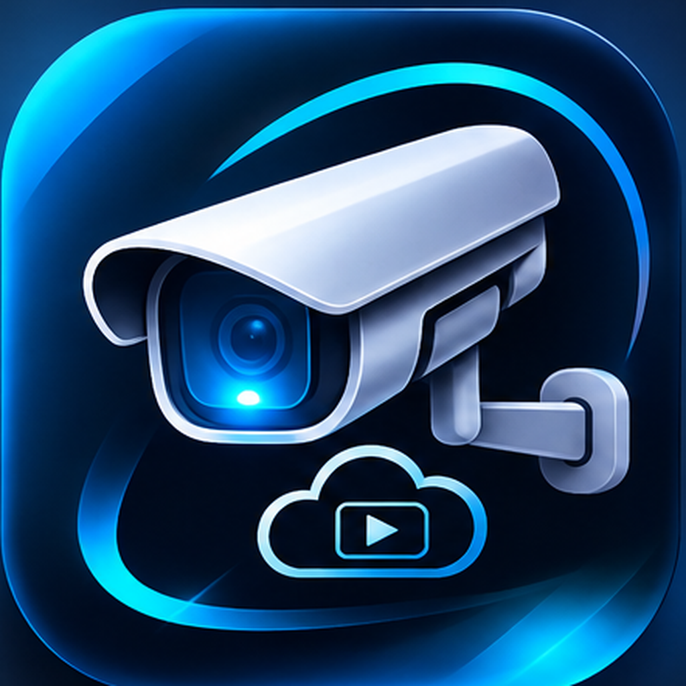
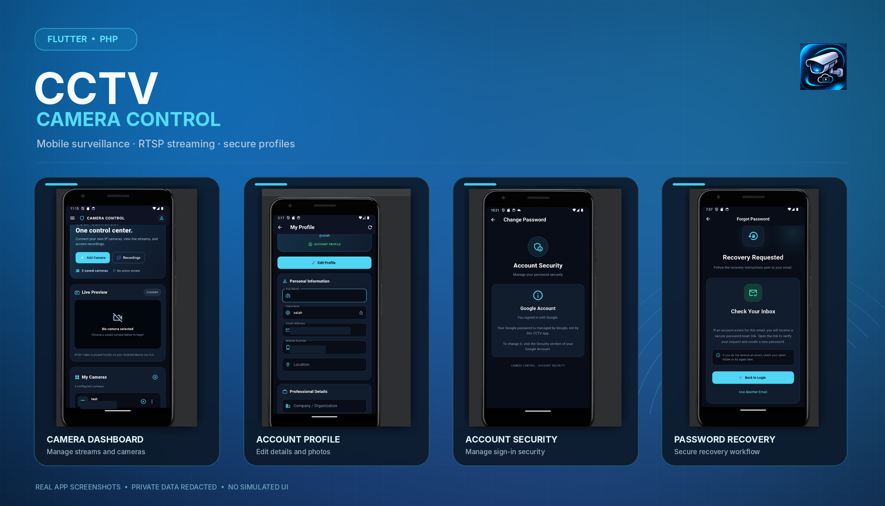
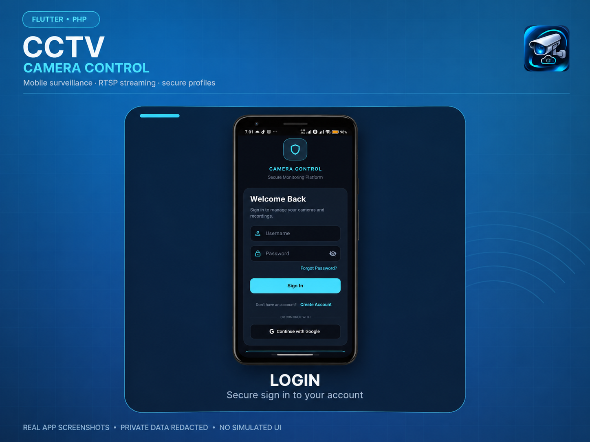
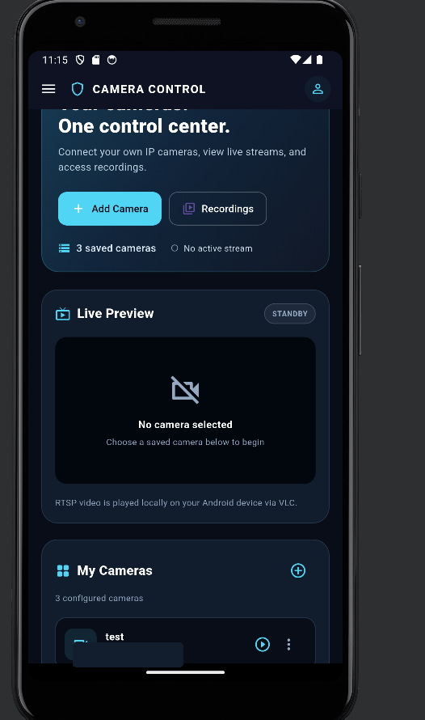
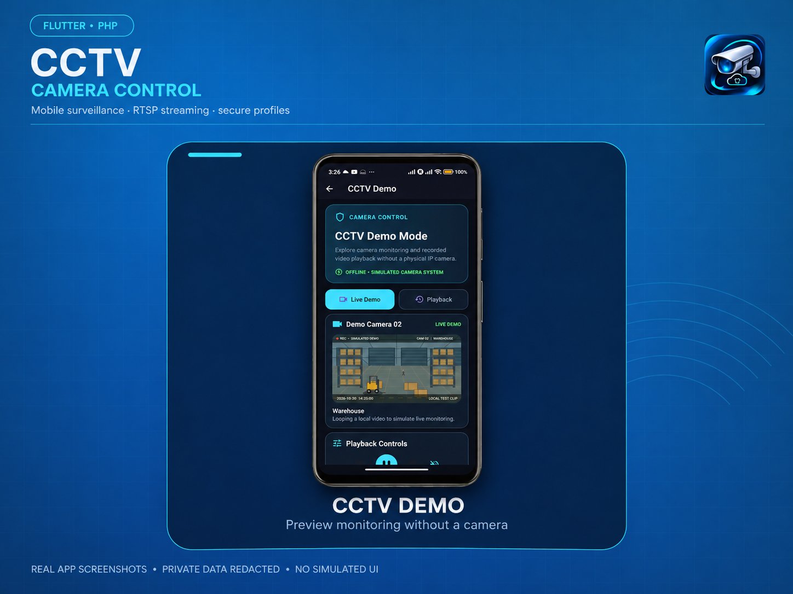
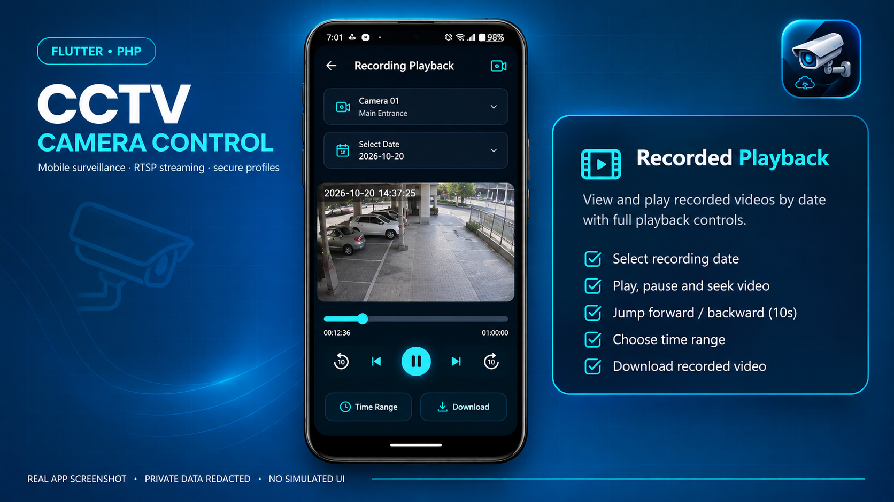
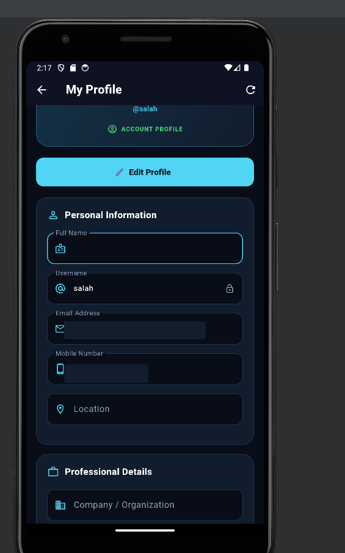
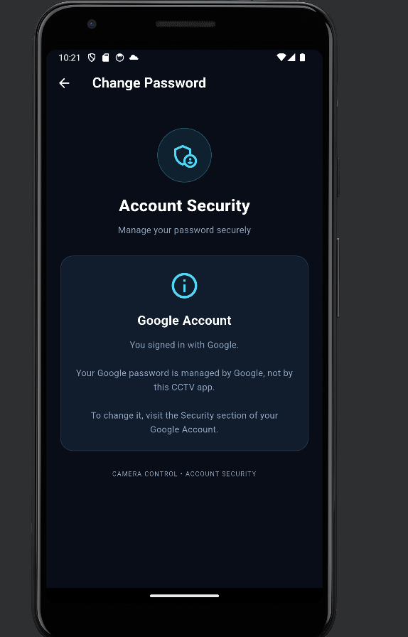
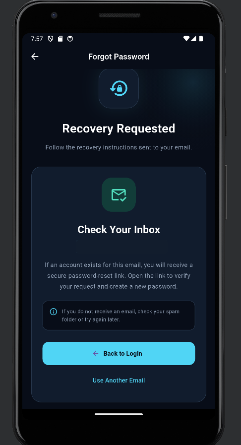

<div align="center">



# CCTV Camera Control

### Smart CCTV Monitoring & Surveillance Management

A Flutter-based CCTV application featuring live camera
streaming, recorded video playback, secure authentication,
and a modern dark-themed interface.

**Flutter • Dart • PHP • MySQL • RTSP • VLC**

</div>

---

## About the Project

CCTV Camera Control is a mobile application designed
to simplify IP camera monitoring and management.

The application combines Flutter with a PHP/MySQL
backend to provide secure account management,
live video streaming, and recorded video playback.

## Features

### Authentication & Account Management
- Secure login and registration
- Google Sign-In
- Stay signed in using session authentication
- Forgot password and password reset
- Change password
- Logout and session management

### User Profile
- View and update profile information
- Upload and remove profile pictures
- Optimized image uploads
- Fast profile reopening with memory caching

### CCTV Monitoring
- Add and manage IP cameras
- RTSP live streaming using VLC
- Camera selection and management
- Date-based recording playback
- Playback controls
- Offline demonstration cameras and videos

### User Interface
- Modern dark and futuristic design
- Cyan accent colors
- Custom application launcher icon
- Mobile-friendly Flutter interface

## Technology Stack

| Category | Technologies |
|---|---|
| Mobile | Flutter, Dart |
| Backend | PHP, REST APIs |
| Database | MySQL / MariaDB |
| Authentication | Google Sign-In, Session Tokens |
| Video Streaming | RTSP, VLC |
| Video Playback | flutter_vlc_player, video_player |
| Local Storage | SharedPreferences |
| Secure Storage | FlutterSecureStorage |
| Hosting | HelioHost |
| Version Control | Git, GitHub |

## Project Structure

```text
camera/
├── android/
├── ios/
├── lib/
│   ├── main.dart
│   ├── login.dart
│   ├── register.dart
│   ├── home.dart
│   ├── profile.dart
│   ├── RecordingScreen.dart
│   ├── playback_screen.dart
│   └── demo_screen.dart
├── backend/
│   ├── login.php
│   ├── register.php
│   ├── google_login.php
│   ├── check_session.php
│   ├── logout.php
│   ├── change_password.php
│   ├── request_password_reset.php
│   ├── reset_password.php
│   ├── getUserDetails.php
│   ├── update_profile.php
│   └── profile_auth.php
├── assets/
│   ├── app_icon.png
│   └── videos/
└── pubspec.yaml
```

## Getting Started

### Requirements

- Flutter SDK
- Android Studio or VS Code
- Android emulator or physical Android device
- PHP/MySQL backend for account features
- Compatible IP camera for real RTSP playback

### Installation

Clone the repository:

```bash
git clone https://github.com/salah804/cctv-camera-control.git
cd cctv-camera-control
```

Install dependencies:

```bash
flutter pub get
```

Run the application:

```bash
flutter run
```

### Backend Configuration

The PHP source is located in the `backend/` folder.

Configure your own PHP hosting, MySQL database,
email service, and authentication settings.

The repository intentionally excludes production
database passwords, private configuration files,
and other credentials.

The provided configuration examples are templates.
A complete database migration is not currently included.

## Security Notes

- Passwords are stored using secure password hashing.
- Authenticated profile requests use Bearer tokens.
- Sensitive production configuration is excluded.
- Do not publish private RTSP camera credentials.
- Camera configuration is stored locally; additional
  protection may be needed for sensitive deployments.

## 📱 Application Screenshots

<div align="center">

### Explore CCTV Camera Control

A modern Flutter-based surveillance application combining secure account management, IP camera monitoring, and recorded video playback.

**Secure Authentication • Camera Management • Live Monitoring • Video Playback**

</div>

---

### 🚀 Application Showcase

<div align="center">
  

  <p><i>An overview of the CCTV Camera Control mobile application, featuring its modern dark interface and core functionality.</i></p>
</div>

---

### 🔐 01 — Authentication & Registration

Secure account access with traditional authentication, Google Sign-In, and user registration.

<table>
  <tr>
    <th align="center" width="50%">Login</th>
    <th align="center" width="50%">Create Account</th>
  </tr>
  <tr>
    <td align="center">
      
    </td>
    <td align="center">
      
    </td>
  </tr>
  <tr>
    <td align="center">Secure sign-in with Google authentication support.</td>
    <td align="center">Account registration with password validation.</td>
  </tr>
</table>

---

### 📹 02 — Camera Dashboard & Live Monitoring

Monitor connected IP cameras, manage camera configurations, and explore the application's demonstration mode.

<table>
  <tr>
    <th align="center" width="50%">Camera Dashboard</th>
    <th align="center" width="50%">CCTV Live Demo</th>
  </tr>
  <tr>
    <td align="center">
      
    </td>
    <td align="center">
      
    </td>
  </tr>
  <tr>
    <td align="center">Manage cameras and access monitoring features.</td>
    <td align="center">Explore simulated live monitoring without a physical IP camera.</td>
  </tr>
</table>

---

### 🎬 03 — Video Recording & Playback

Access recorded video, navigate playback timelines, and control video playback.

<div align="center">
  

  <p><i>Video playback with recording navigation and playback controls.</i></p>
</div>

---

### 👤 04 — User Profile & Account Security

Personalize your account information and access security settings.

<table>
  <tr>
    <th align="center" width="50%">User Profile</th>
    <th align="center" width="50%">Account Security</th>
  </tr>
  <tr>
    <td align="center">
      
    </td>
    <td align="center">
      
    </td>
  </tr>
  <tr>
    <td align="center">View and update personal details and profile photos.</td>
    <td align="center">Manage password and account security options.</td>
  </tr>
</table>

---

### 🔑 05 — Password Recovery

A dedicated password recovery flow helps users regain access to their accounts securely.

<div align="center">
  

  <p><i>Secure email-based password recovery workflow.</i></p>
</div>

---

<div align="center">

### 🛡️ Built for Secure & Modern Surveillance

**Flutter • Dart • PHP • MySQL • RTSP • VLC**

Designed to combine mobile usability, account management, and camera monitoring in one application.

</div>


## Developer

**Salah Ayash**

Full-Stack, Mobile & web & Cloud Developer

GitHub: https://github.com/salah804

---

Built with Flutter, PHP and MySQL.

